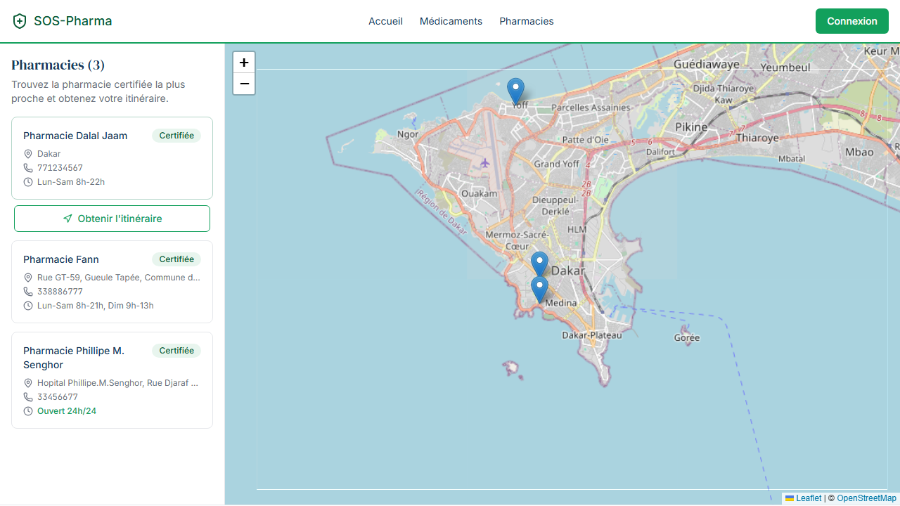
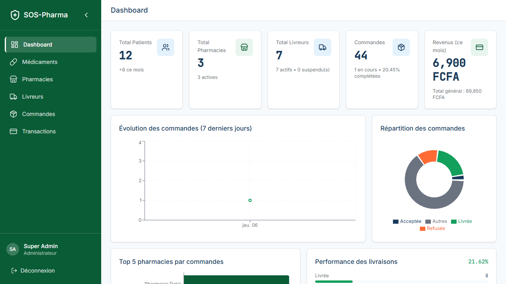
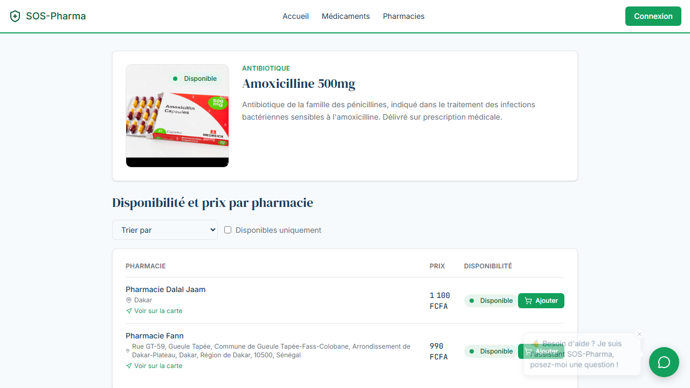
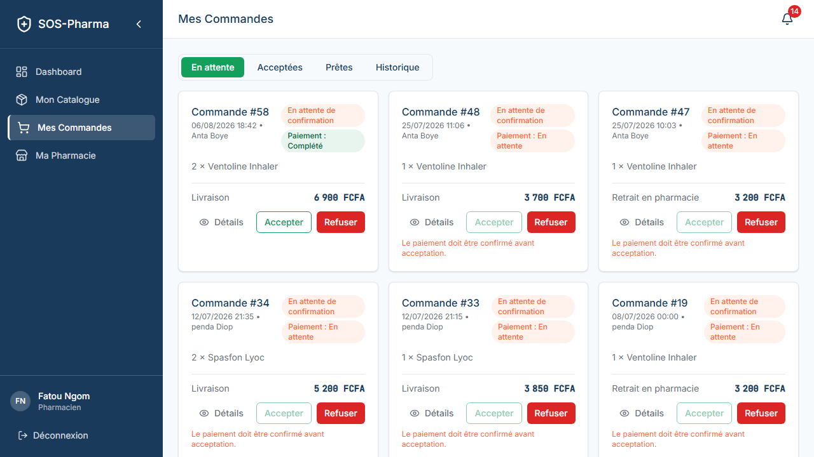

# SOS-Pharma — Application web

**SOS-Pharma** est une plateforme qui aide les habitants de Dakar (Sénégal) à trouver des médicaments, comparer les prix entre pharmacies certifiées, localiser la plus proche et commander en ligne, avec retrait en pharmacie ou livraison à domicile.

Ce dépôt contient le **front-end web** (React + Vite) de la plateforme. Il s'adresse à quatre types d'utilisateurs : visiteurs, patients, pharmaciens et administrateurs.


## Fonctionnalités

**Public (sans compte)**
- Recherche et catalogue de médicaments, avec une fiche détaillée affichant la **comparaison des prix par pharmacie**
- **Carte interactive des pharmacies** (Leaflet / OpenStreetMap) : horaires, distance depuis la position de l'utilisateur et itinéraire directement depuis la carte
- **Chatbot IA** flottant avec réponses courtes et formatées, et messages vocaux

**Patient**
- Inscription avec code de confirmation à 6 chiffres envoyé par email, connexion, profil
- Panier (une seule pharmacie par panier), passage de commande avec **retrait en pharmacie ou livraison à domicile**
- Paiement mobile / carte (Wave, Orange Money, Free Money, carte bancaire) avec pages de succès et d'échec
- Historique des commandes, détail, modification, **ticket de paiement** imprimable
- Notifications

**Pharmacien**
- Tableau de bord avec statistiques et graphiques
- Gestion du catalogue : ajout depuis le référentiel de médicaments, modification des prix, disponibilité, **import CSV/Excel avec aperçu**
- Commandes reçues par statut (en attente, acceptées, prêtes, historique) : accepter / refuser / marquer prête
- Profil de la pharmacie ; inscription d'une pharmacie soumise à certification par l'administrateur

**Administrateur**
- Tableau de bord : indicateurs clés, évolution des commandes, répartition par statut, top pharmacies, performance des livraisons
- Gestion du référentiel de médicaments
- Certification des pharmacies (en attente / certifiées / suspendues) et pages de détail
- Gestion des livreurs
- Vue d'ensemble des commandes et des transactions de paiement

L'accès est géré par rôle (`patient`, `pharmacien`, `administrateur`) grâce à des routes protégées.

## Stack technique

| Domaine | Outils |
|---|---|
| Framework | React 19, Vite |
| Routage | React Router 7 (pages chargées à la demande, routes protégées par rôle) |
| Données | TanStack React Query, Axios (avec intercepteur d'authentification) |
| Style | Tailwind CSS 4 |
| Cartographie | Leaflet, React-Leaflet, OpenStreetMap, OSRM (itinéraires), Nominatim (géocodage inverse) |
| Graphiques | Recharts |
| Interface | Icônes Lucide, react-hot-toast |
| Tests | Playwright (end-to-end) |
| Qualité | ESLint |

## Architecture

La plateforme repose sur trois dépôts distincts :

| Partie | Description | Dépôt |
|---|---|---|
| **Web** (ce dépôt) | Application React monopage | public |
| **API backend** | API REST Laravel (authentification par token Sanctum) | privé — code disponible sur demande |
| **Application mobile** | Application mobile compagnon | privé — code disponible sur demande |

L'application web communique avec le backend via l'API REST configurée par `VITE_API_URL`. Le code suit l'approche **Atomic Design** (atoms → molecules → organisms → templates → pages), avec un module d'API et un fichier de hooks React Query par domaine.

## Structure du projet

```
.
├── docs/                 # Charte graphique et feuille de route
├── e2e/                  # Tests Playwright (+ captures dans e2e/captures)
├── public/
├── src/
│   ├── api/              # Instance Axios et un module d'API par domaine
│   ├── components/
│   │   ├── atoms/        # Button, Input, Badge, Modal, ...
│   │   ├── molecules/    # SearchBar, MedicamentCard, Sidebar, ...
│   │   ├── organisms/    # Chatbot, CatalogueTable, DashboardStats, ...
│   │   └── templates/    # Layouts Public / Admin / Pharmacien
│   ├── contexts/         # AuthContext, PanierContext
│   ├── hooks/            # Hooks React Query par domaine
│   ├── pages/            # admin/, auth/, patient/, pharmacien/, public/
│   ├── router/           # AppRouter, PrivateRoute, RoleRoute
│   └── utils/            # constantes, formateurs, utilitaires géo
├── playwright.config.js
└── vite.config.js
```

## Installation et lancement

**Prérequis :** Node.js 20+ et une instance du backend en fonctionnement (privé, voir ci-dessus).

```bash
npm install
cp .env.example .env     # puis renseigner VITE_API_URL avec l'URL de base de l'API backend
npm run dev
```

L'application tourne sur http://localhost:5173 (port fixe : `strictPort` est activé car le backend redirige vers ce port après un paiement).

Autres scripts : `npm run build`, `npm run preview`, `npm run lint`.

## Tests end-to-end

La suite Playwright du dossier [`e2e/`](e2e) couvre la connexion (succès et échec), l'inscription patient, la recherche de médicaments et la comparaison de prix, la carte des pharmacies, le parcours panier → commande, le tableau de bord / catalogue / commandes du pharmacien, le tableau de bord / pharmacies / livreurs de l'administrateur, et le chatbot. Les tests s'exécutent contre un backend réel avec des comptes de test.

```bash
npx playwright install chromium
cp e2e/.env.example e2e/.env     # renseigner les identifiants des comptes de test
npm run dev                      # dans un premier terminal
npx playwright test              # dans un second terminal
npx playwright show-report       # ouvrir le rapport HTML
```

Les captures d'écran prises par les tests sont enregistrées dans [`e2e/captures`](e2e/captures).

## Captures d'écran

| Carte des pharmacies | Tableau de bord admin |
|---|---|
|  |  |

| Comparaison des prix | Commandes du pharmacien |
|---|---|
|  |  |

## Documentation

- [`docs/DESIGN.md`](docs/DESIGN.md) — identité visuelle et consignes d'interface
- [`docs/ROADMAP.md`](docs/ROADMAP.md) — plan de développement par phase

## Auteure

**Thiané Boye** — [GitHub](https://github.com/Tbyb)
